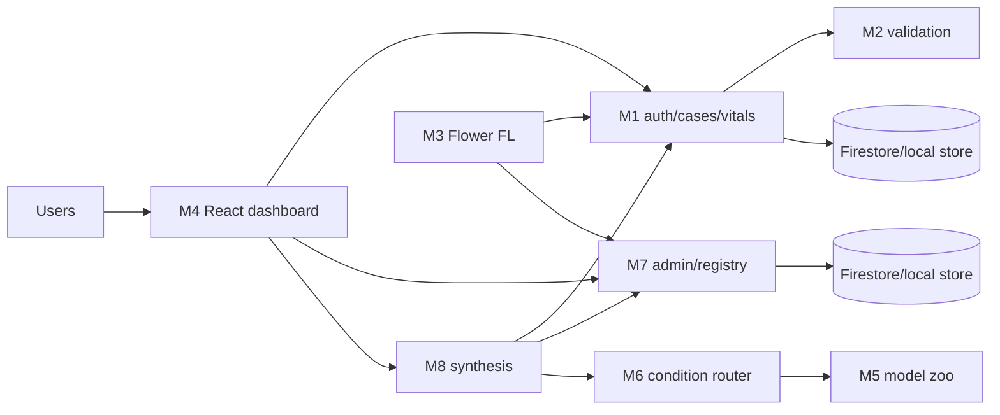

# FedHeal

FedHeal is a research/MVP federated-learning healthcare AI platform. It
provides hospital-scoped clinical decision support: structured vitals are
validated, local hospital training updates are aggregated with FedAvg, and a
clinician-review packet can report model output, missing inputs, and available
explanations.

> **Not clinically validated.** The system does not provide a diagnosis,
> treatment, medication, or dose. Imaging analysis is currently unavailable.
> The optional UCI fallback is a **NON-CLINICAL DEMO** and is not a federated
> hospital model.

## Repository layout

```text
client/dashboard/          React/Vite dashboard and Playwright configuration
server/auth/               Authentication, users, hospitals, cases, and vitals
server/validation/         Stateless vitals validation
server/federated-server/   Central Flower server and FedAvg aggregation
server/model-zoo/          Specialist model contracts and registry
server/condition-router/   Condition routing and explainers
server/admin/              Platform registry, rounds, and promotion controls
server/synthesis/          Clinician-review synthesis HTTP service
server/shared/             Shared-code audit notes; service copies remain local
hospital-node/             Hospital-local federated client and local datasets
infra/                     Compose, Firestore/Firebase, and deployment examples
scripts/                   Cross-platform local run and test helpers
docs/                      Architecture, API, setup, security, and runbooks
```

## Architecture



Modules 5 and 6 are libraries imported by Module 8. Ports are M1 `8001`, M2
`8002`, M7 `8005`, M8 `8006`, dashboard `5173`, and Flower `8080` when its
Compose profile is enabled.

## Quick start

Requirements: Python 3.11+, Node.js 18+, and optionally Docker/Compose.

```bash
python3 -m venv .venv
source .venv/bin/activate
export FEDHEAL_ENV=development
for m in server/auth server/validation server/federated-server server/model-zoo server/condition-router server/admin server/synthesis; do
  python -m pip install -r "$m/requirements.txt"
done
cp infra/deploy/compose.env.example .env
python server/auth/create_super_admin.py --email admin@example.invalid
python -m uvicorn main:app --app-dir server/auth --port 8001
```

Start the remaining services in separate terminals, or use
`scripts/run-one.sh` / `scripts/run-one.ps1`. For the full container path,
copy `infra/deploy/compose.env.example` to `.env`, replace placeholders, and
run `docker compose -f infra/docker-compose.yml up --build`. See
[SETUP.md](docs/SETUP.md).

The dashboard API origins are configurable at build time with
`VITE_AUTH_API_BASE`, `VITE_ADMIN_API_BASE`, and `VITE_SYNTHESIS_API_BASE`.
They are public URLs, not credentials. CORS remains controlled by the server
side `FEDHEAL_DASHBOARD_ORIGIN` setting.

## Local scripts

```text
scripts/run-one.ps1 <service>       Windows service runner
scripts/run-one.sh <service>        Linux/macOS service runner
scripts/run-all.ps1                 Start local HTTP services and dashboard
scripts/run-all.sh                  Start local HTTP services and dashboard
scripts/test-all.ps1                Run all discovered Python test suites
scripts/test-all.sh                 Run all discovered Python test suites
```

Supported services are `auth`, `validation`, `federated-server`, `admin`,
`synthesis`, and `dashboard`. These scripts do not create a virtual
environment, install dependencies, or use Docker.

## Documentation

- [Architecture](docs/ARCHITECTURE.md)
- [Modules](docs/MODULES.md)
- [API reference](docs/API_REFERENCE.md)
- [Data model](docs/DATA_MODEL.md)
- [Federated learning](docs/FEDERATED_LEARNING.md)
- [Security](docs/SECURITY.md)
- [Setup](docs/SETUP.md)
- [Testing and verification](docs/TESTING.md)
- [Status and roadmap](docs/STATUS_AND_ROADMAP.md)
- [Model status](docs/MODEL_STATUS.md)
- [MVP scope](docs/MVP_SCOPE.md)
- [Demo runbook](docs/DEMO_RUNBOOK.md)

## Current verification

The current refactor verification passed the dashboard production build,
Python compilation, moved-service import smoke checks, Docker Compose
configuration validation using `infra/deploy/compose.env.example`, and local
HTTP health checks for auth, validation, admin, synthesis, and the dashboard.
The repository contains no discoverable Python or Playwright test files, so
the backend test commands report “no tests ran” rather than a pass count.
Full Docker image startup and multi-machine federated training remain
unverified.

## Safety boundary

Hospital identity comes from signed tokens, not client-supplied hospital
fields. Firestore client rules deny direct access. Service-to-service calls
use short-lived scoped JWTs. These controls are application/prototype
boundaries; TLS, secure aggregation, a formal differential-privacy guarantee,
production secret management, and clinical validation are not established by
this repository.
