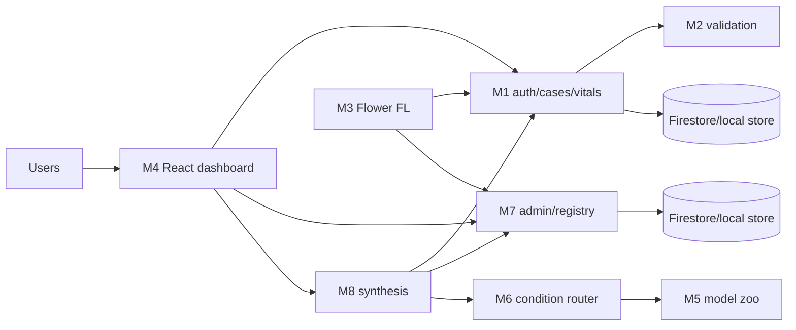

# FedHeal

FedHeal is a research/MVP federated-learning healthcare AI platform. It
provides hospital-scoped clinical decision support: structured vitals are
validated, local hospital training updates are aggregated with FedAvg, and a
clinician-review packet can report model output, missing inputs, and available
explanations.

> **Not clinically validated.** The system does not provide a diagnosis,
> treatment, medication, or dose. Imaging analysis is currently unavailable.
> The optional UCI fallback is a **NON-CLINICAL DEMO** and is not a federated
> hospital model.

## Architecture



Modules 5 and 6 are libraries imported by Module 8. Ports are M1 `8001`, M2
`8002`, M7 `8005`, M8 `8006`, dashboard `5173`, and Flower `8080` when its
Compose profile is enabled.

## Quick start

Requirements: Python 3.11+, Node.js 18+, and optionally Docker/Compose.

```bash
python3 -m venv .venv
source .venv/bin/activate
export FEDHEAL_ENV=development
for m in server/auth server/validation module3-fedlearning server/model-zoo server/condition-router server/admin server/synthesis; do
  python -m pip install -r "$m/requirements.txt"
done
cp infra/deploy/compose.env.example .env
python server/auth/create_super_admin.py --email admin@example.invalid
python -m uvicorn main:app --app-dir server/auth --port 8001
```

Start Modules 2, 7, 8 and the dashboard in separate terminals. For the full
container path, copy `infra/deploy/compose.env.example` to `.env`, replace
placeholders, and run `docker compose up --build`. See [SETUP.md](docs/SETUP.md).

## Documentation

- [Architecture](docs/ARCHITECTURE.md)
- [Modules](docs/MODULES.md)
- [API reference](docs/API_REFERENCE.md)
- [Data model](docs/DATA_MODEL.md)
- [Federated learning](docs/FEDERATED_LEARNING.md)
- [Security](docs/SECURITY.md)
- [Setup](docs/SETUP.md)
- [Testing and verification](docs/TESTING.md)
- [Status and roadmap](docs/STATUS_AND_ROADMAP.md)
- [Model status](docs/MODEL_STATUS.md)
- [MVP scope](docs/MVP_SCOPE.md)
- [Demo runbook](docs/DEMO_RUNBOOK.md)

## Current verification

In the documentation pass, the React production build passed. Python test
execution was not possible because `pytest` is not installed and no test files
are present in this checkout. Docker Compose validation was not possible
because the root `.env` file was absent. No test count is claimed.

## Safety boundary

Hospital identity comes from signed tokens, not client-supplied hospital
fields. Firestore client rules deny direct access. Service-to-service calls
use short-lived scoped JWTs. These controls are application/prototype
boundaries; TLS, secure aggregation, a formal differential-privacy guarantee,
production secret management, and clinical validation are not established by
this repository.
