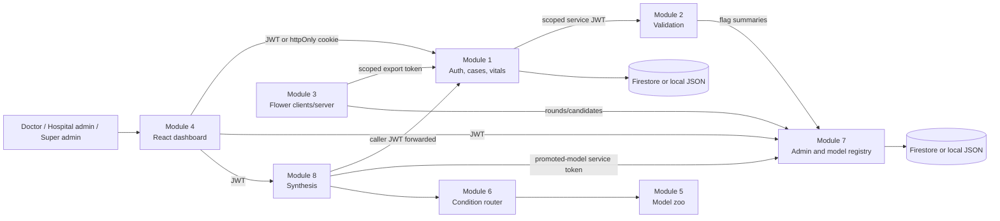

# FedHeal architecture

## Purpose and boundaries

FedHeal is an eight-module prototype for hospital-scoped healthcare decision
support. A hospital uploads structured vitals, history, a current condition,
and scan metadata. The system validates structured data, trains a shared
vitals model with federated learning, routes conditions to specialist
implementations, and returns a clinician-review packet with model status and
explanations where available.

The repository does **not** implement a clinically validated diagnostic or
treatment system. Scan analysis is currently an explicit unavailable response.
The optional UCI Cleveland model is a non-clinical demo fallback and is not a
federated hospital model.

## Repository layout

User-facing code lives under `client/dashboard`. HTTP services and backend
libraries live under `server/`, the central Flower process is under
`server/federated-server`, and hospital-local federated code plus demo data
lives under `hospital-node`. Deployment configuration is under `infra/`.

## Service topology

The model zoo and condition router are Python libraries, not standalone HTTP
services. Synthesis imports them directly. The federated server is exposed on
port 8080 only when the Compose `federation` profile is enabled.

## Dashboard/server contract

The dashboard reads its public service origins from build-time Vite
variables: `VITE_AUTH_API_BASE`, `VITE_ADMIN_API_BASE`, and
`VITE_SYNTHESIS_API_BASE`. They default to the local ports shown above and are
also passed as Docker build arguments; they contain URLs only, never secrets.

Browser requests send the existing `Authorization: Bearer <JWT>` header when
the caller supplies a token and always include credentials so the existing
httpOnly session-cookie flow remains available. The dashboard does not hold
service credentials. Auth, admin, and synthesis services continue to enforce
their existing CORS allow-list from `FEDHEAL_DASHBOARD_ORIGIN`, and all role,
hospital-scope, JWT, cookie, and service-token rules remain server-side.

## End-to-end data flow

1. **Module 1** authenticates users, derives `hospital_id` and role from the
   signed user token, and owns hospitals, users, cases, history, vitals, scans,
   analyses, reviews, and audit records.
2. **Module 2** receives a short-lived Module 1 service token and validates
   vitals through forbidden-field, schema, range, consistency, optional
   required-label, and batch anomaly checks. It returns `passed`, `flagged`, or
   `rejected`; it does not persist patient records.
3. **Module 3** loads only a hospital's eligible records through a
   hospital-scoped Module 1 token. Local Flower clients train the shared
   logistic-regression model. The server aggregates model updates and sends
   round/candidate metadata to Module 7.
4. **Module 7** stores round summaries, count-only validation flags,
   retraining requests, and model registry metadata. A candidate must pass the
   validation gate and be explicitly promoted by `super_admin` before serving.
5. **Module 5** supplies specialist model contracts, the runnable vitals
   specialist, fusion support, and explicit stubs/fallbacks for unavailable
   imaging/foundation models.
6. **Module 6** resolves a condition name to registered specialists and
   explainers. It does not infer a modality from raw pixels.
7. **Module 8** reads the caller-visible record/case from Module 1, reads the
   promoted model from Module 7, calls Modules 5/6, and returns a structured
   synthesis with `requires_clinician_review=true`.
8. **Module 4** renders login, hospital/federation status, uploads, reviews,
   cases, model rounds, and synthesis results. No service credential is
   embedded in the browser.

## Roles and permissions

| Principal | Verified permissions |
|---|---|
| `super_admin` | Create/update hospitals and admin users in Module 1; view Module 7 platform data; validate, promote, and roll back models; trigger queued retraining requests. |
| `hospital_admin` | Manage doctors for the own hospital; use hospital-scoped vitals and flagged-record workflows. |
| `clinician` | Create and update own-hospital cases, history, case vitals, scans, analyses, and clinician reviews. |
| Service accounts | Short-lived HS256 service JWTs identify caller (`sub`), endpoint family (`aud`), expiry, and optional hospital scope (`hid`). They are used only on internal endpoints. |

Every human request obtains `hospital_id` from the verified user JWT. Case,
history, scan, vitals, review, and analysis queries re-check hospital
ownership. Module 3 export tokens are hospital-scoped. Module 2 and Module 7
exchange summaries/counts rather than patient rows. Firestore rules deny all
direct browser reads and writes; application services use server credentials.

## Technology and design decisions

- Python/FastAPI services use dataclasses plus repository/docstore adapters.
- Firestore is the staging/production backend; development uses a local JSON
  store by default and tests can use an in-memory backend.
- JWT user sessions use `FEDMED_JWT_SECRET`; internal calls use separate
  service-token signing keys per hop.
- Module 1 and Module 7 own separate collection sets and can share a Firestore
  project/database or use Module 7's named database.
- Module 7 separates candidate registration, validation, promotion, and
  rollback. Training completion never deploys a model automatically.
- Module 8 prefers a promoted federated model. The UCI fallback is disabled
  unless `FEDHEAL_ALLOW_DEMO_MODEL=true` and is labelled non-clinical.
- The dashboard is React 18/Vite. Module 3 uses Flower, NumPy, scikit-learn,
  and deterministic weighted FedAvg for the current vitals model.

## Verified limitations

TLS is optional in the Flower adapter and Compose defaults to plaintext.
Secure aggregation is not implemented. Update clipping/noise code exists as
experimental opt-in behavior without a privacy accountant or epsilon-DP
claim. See [FEDERATED_LEARNING.md](FEDERATED_LEARNING.md) and
[SECURITY.md](SECURITY.md).
